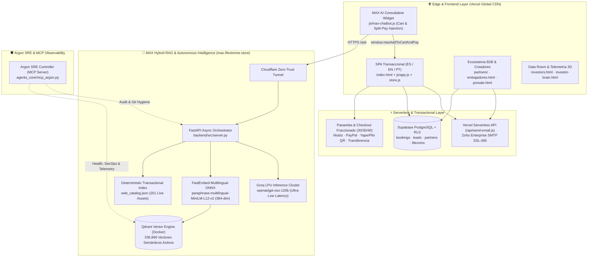

# 🏔️ LIFEXTREME AI — Enterprise Adventure Tech & Hybrid RAG Platform

[-10b981?style=for-the-badge)](https://www.lifextreme.store)
[](https://max.lifextreme.store/health)
[](#4-argon-sre--devsecops-governance)

**Lifextreme (`www.lifextreme.store`)** es una plataforma tecnológica verticalmente integrada para el sector de **Turismo de Aventura, Alta Montaña, Eventos Outdoor e Infraestructura Turística en Latinoamérica**, respaldada por un motor propio de Inteligencia Artificial Conversacional y Regulatoria (**MAX Hybrid RAG Engine**) con **336,869 vectores semánticos activos**.

---

## 1. Arquitectura del Sistema (System Architecture)



---

## 2. Especificaciones Técnicas por Capa (Due Diligence Stack)

### 2.1 Motor de Inteligencia Artificial y RAG Híbrido (`backend/src/server.py`)
A diferencia de wrappers genéricos de LLM, Lifextreme implementa un **pipeline RAG híbrido de doble vía** optimizado para precisión comercial, cumplimiento normativo y latencia sub-segundo:

1. **Recuperación Determinística Transaccional (`backend/src/web_catalog.json`):**
   - Indexación estructurada en memoria de **251 activos comerciales verificados**:
     - **40 Expediciones y Tours técnicos** (Cusco, Huaraz/Áncash, Arequipa, Iquitos, Puno, Lima, etc.).
     - **28 Eventos y Competencias Outdoor** (Ultra Trails, Maratones de Montaña, Festivales de Escalada).
     - **164 Parques de Aventura e Infraestructura** certificados a nivel nacional.
     - **4 Guías UIAGM/AGMP** y **15 Equipos Técnicos de Alta Montaña**.
2. **Memoria Vectorial Masiva en Qdrant (`336,869 vectores` en 384 dimensiones):**
   - `Lifextreme_FQSA_Knowledge`: **176,216 vectores** (inteligencia operativa, logística regional, rutas, objeciones de ventas y protocolos médicos de altitud).
   - `Lifextreme_Knowledge`: **160,653 vectores** (normativa MINCETUR, SERNANP, INDECOPI, TUPA, SENAMHI y matrices legales B2B).
3. **Inferencia de Baja Latencia y AltaDisponibilidad:**
   - **Primario:** **Groq LPU (`openai/gpt-oss-120b`)** con tiempos de respuesta `< 800 ms`.
   - **Secundario (Fallback Local):** **Ollama (`llama3.2:latest`)** para resiliencia offline.
4. **Cierre Transaccional en el Chat (`[CARRITO: Nombre | Precio | Pax]`):**
   - El agente consultivo perfila al viajero (grupo, experiencia, fechas), calcula presupuestos grupales y el **Plan de Reserva Fraccionada 30%-30%-40%**, e inyecta botones interactivos que cargan la mochila de compra (`window.maxAddToCartAndPay`) y abren la pasarela de pago en un clic.

### 2.2 Plataforma Transaccional & Motores de Conversión (`js/`)
- **Arquitectura Modular Vanilla ES6+ sin sobrecarga de hidratación:** Carga instantánea en redes móviles de montaña (3G/4G), logrando métricas sobresalientes en Core Web Vitals.
- **Internacionalización Nativa (i18n) y Multimoneda:** Soporte completo para Español (`/index.html`), Inglés (`/en/index.html`) y Portugués (`/pt/index.html`), con conversión dinámica `PEN / USD / EUR` (`js/price-engine.js`).
- **Checkout con Reserva Fraccionada 30/30/40 (`js/app.js`):** Cálculo algorítmico de cronogramas de pago (30% hoy para bloqueo de cupo, 30% 24h antes del despliegue, 40% el día de la expedición), sincronizado con **Supabase PostgreSQL** (`js/booking-service.js`) y emisión de **Boarding Pass Táctico con QR** vía **Zoho Enterprise SMTP** (`api/send-email.js`).
- **Cumplimiento Legal Peruano (INDECOPI Ley N° 29571):** Libro de Reclamaciones Virtual (`reclamaciones.html`) con generación de ticket correlativo (`REC-2026-XXXXXX`), constancia imprimible y despacho automático a cumplimiento legal.

---

## 3. Estructura del Repositorio

```text
Lifextreme-Web-AI/
├── index.html                        # Aplicación Principal B2C (ES)
├── en/index.html                     # Aplicación B2C Internacional (EN)
├── pt/index.html                     # Aplicación B2C Brasil/LATAM (PT)
├── partners/                         # Portal B2B para Operadores y Agencias
├── investors.html                    # Portal de Inversionistas (Telemetría en Vivo)
├── investor-brain.html               # Topología Neuronal 3D (WebGL / Three.js)
├── embajadores.html                  # Creators Hub & Ticketera de Eventos Outdoor
├── presale.html                      # Portal de Preventa Fundadores (Lifecoins)
├── reclamaciones.html                # Libro de Reclamaciones Virtual (INDECOPI)
├── terminos.html / privacidad.html   # Marco Legal y Protección de Datos
├── api/
│   └── send-email.js                 # Función Serverless (Vercel) -> Zoho SMTP SSL
├── js/
│   ├── app.js                        # Orquestador SPA, Carrito y Checkout 30/30/40
│   ├── max-chatbot.js                # Cliente Conversacional MAX + Inyección a Carrito
│   ├── data.js                       # Catálogo Maestro (Tours, Eventos, Parques, Guías)
│   ├── infrastructure.js             # Motor de 164 Parques de Aventura + Schema.org
│   ├── supabase-client.js            # Cliente Relacional Supabase (Bookings & Leads)
│   ├── booking-service.js            # Servicio de Persistencia y Boarding Pass
│   ├── forms-handler.js              # Manejador Universal de Formularios B2C/B2B
│   └── config.js                     # Configuración Corporativa Centralizada
├── backend/
│   └── src/
│       ├── server.py                 # API FastAPI (RAG Híbrido + Telemetría /health)
│       └── web_catalog.json          # Índice Determinístico Sincronizado (251 ítems)
└── agents_core/
    ├── mcp_argon.py                  # Servidor MCP (Model Context Protocol) Argon SRE
    └── argon/sre_controller.py       # Auditoría de Recursos, Qdrant, Git y SecOps
```

---

## 4. Argon SRE & DevSecOps Governance

El proyecto integra **Argon SRE**, un servidor **Model Context Protocol (MCP)** propio (`agents_core/mcp_argon.py`) que audita en tiempo real:
- `argon_auditar_recursos`: Telemetría de CPU, RAM y almacenamiento en nodos de inferencia.
- `argon_estado_qdrant`: Verificación de salud y conteo de vectores en colecciones Qdrant (`localhost:6333`).
- `argon_secretos_expuestos`: Escaneo estático de seguridad para prevenir fugas de credenciales en código fuente.
- `argon_imports_rotos` & `argon_auditoria_git`: Integridad de dependencias y trazabilidad del repositorio.

### Seguridad en Producción (`vercel.json` & `.vercelignore`)
- **Headers de Seguridad Activos:** `Content-Security-Policy (CSP)`, `X-Frame-Options: DENY`, `X-Content-Type-Options: nosniff`, `Referrer-Policy: strict-origin-when-cross-origin`, `Permissions-Policy`.
- **Aislamiento de Despliegue:** `.vercelignore` excluye estrictamente archivos `.env`, scripts de ingesta y bases de datos locales del CDN público.

---

## 5. Despliegue y Verificación Rápida (Para Auditores Técnicos)

### 5.1 Verificar el Backend IA en Producción
```bash
curl https://max.lifextreme.store/health
```
Respuesta esperada:
```json
{
  "status": "ok",
  "engine": "Groq (openai/gpt-oss-120b) + Qdrant RAG",
  "qdrant_vectors": 336869,
  "catalog_items": {
    "tours": 40,
    "events": 28,
    "parks": 164
  }
}
```

### 5.2 Prueba de Consulta Conversacional con Cierre al Carrito
```bash
curl -X POST https://max.lifextreme.store/ask \
  -H "Content-Type: application/json" \
  -d '{"query": "Somos 4 amigos y queremos reservar la expedición a Pacaya Samiria", "history": []}'
```

### 5.3 Ejecución Local del Stack Completo
```bash
# 1. Levantar motor vectorial Qdrant
docker start rag_lifextreme

# 2. Iniciar orquestador FastAPI (Puerto 8000)
python -m uvicorn backend.src.server:app --host 0.0.0.0 --port 8000 --reload

# 3. Desplegar a Producción en Vercel
npx vercel --prod --yes
```

---
© 2026 **Lifextreme Perú S.A.C.** · Calle Chihuampata N° 626, San Blas, Cusco, Perú · [www.lifextreme.store](https://www.lifextreme.store)
