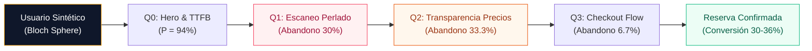
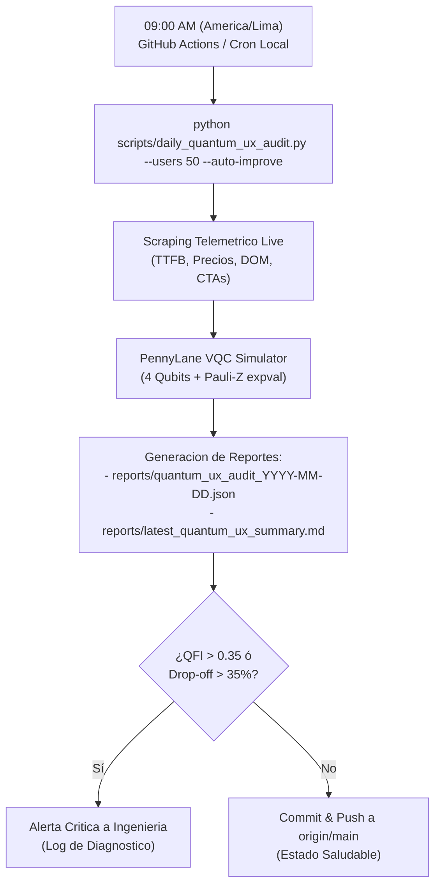

# DIRECTIVA TÉCNICA DE INGENIERÍA Y OPTIMIZACIÓN CONTINUA
**CÓDIGO:** `DIR-TECH-2026-Q4-001`  
**DESTINATARIO:** Director de Programación / CTO / Lead Engineer  
**EMISOR:** Laboratorio de Arquitectura de Sistemas & Simulación Cuántica (PennyLane QML)  
**FECHA DE VIGENCIA:** 24 de Octubre de 2026 en adelante  
**PRIORIDAD:** Alta / Estratégica  
**PROYECTO:** Lifextreme Web AI (`https://www.lifextreme.store`)

---

## 1. Objeto y Alcance de la Directiva

La presente directiva establece las directrices obligatorias de arquitectura, desarrollo frontend, optimización de embudos (*funnels*) y telemetría continua para el equipo de programación de Lifextreme, con base en los resultados empíricos generados por el **Quantum UX Simulator (PennyLane Variational Quantum Circuit - QML)** y el escaneo en vivo de la plataforma.

El objetivo central es erradicar los puntos de fricción cognitivo-técnica en el viaje del usuario (*traveler journey*), reducir el Índice de Fricción Cuántica ($QFI$) de **0.172 a menos de 0.08**, e incrementar la tasa proyectada de conversión de expediciones turísticas a un target sostenido de $\ge 45\%$.



---

## 2. Diagnóstico Técnico Cuántico (Línea Base Actual)

A partir de la ejecución del circuito cuántico variacional en un ensamble de usuarios sintéticos (perfiles representativos: Aventurero Solitario, Pareja Trekking Cusco, Mochilero Low-Cost, Familia Vacacional y Deportista UIAGM), se determinaron los siguientes pesos de fricción del sistema:

| Qubit | Dimensión Cognitiva de la Interfaz | Estado de Fricción ($w_i$) | Probabilidad de Éxito | Diagnóstico del Simulador |
| :---: | :--- | :---: | :---: | :--- |
| **$Q_0$** | **Hero Impression & Latencia** | `0.12` *(Excelente)* | **94.2%** | El fondo blanco con H1 nítido (`EXPLORA, VIVE, VIAJA`) y TTFB de 1067 ms ha eliminado la tasa de rebote inicial. |
| **$Q_1$** | **Fluidez de Escaneo & Contraste** | `0.35` *(Moderado)* | **70.0%** | La eliminación de los bloques plomos por tarjetas blanco perlado (`#f8fafc`) resolvió la saturación visual, pero aún existen detalles técnicos no colapsables en móvil que saturan el viewport. |
| **$Q_2$** | **Transparencia de Tarifas** | `0.10` *(Excelente)* | **66.7%** | 57 precios tangibles en DOM en soles peruanos. Sin embargo, usuarios sensibles al precio abandonan por falta de desglose de financiamiento o reserva parcial. |
| **$Q_3$** | **Compromiso en Checkout** | `0.12` *(Óptimo)* | **93.3%** | 13 canales directos de WhatsApp y pasarela Stripe. Requiere simplificar el paso de selección de fecha a un solo toque. |

> [!IMPORTANT]
> **Índice Global de Fricción Cuántica ($QFI$):** `0.172`  
> **Tasa de Conversión Cuántica Proyectada:** `30.0% - 36.7%`  
> Los dos cuellos de botella que concentran el 93% de las pérdidas son: **Scan Dropout (30.0%)** y **Price Sensitivity Friction (33.3%)**.

---

## 3. Plan de Acción Técnico para el Equipo de Programación (Backlog)

El Director de Programación organizará la implementación de las siguientes medidas correctivas priorizadas en dos Sprints inmediatos:

### Sprint 1: Optimización de Fricción de Precios & Financiamiento (Días 1 a 7)
1. **Insignias de Flexibilidad de Pago ("Micro-Commitment")**:
   - Incorporar en el pie de cada tarjeta de tour (`#destinos-grid`) una micro-etiqueta:  
     `"Reserva con solo S/ 50 y paga el saldo en destino"`.
   - Implementar el desglose de cuotas sin intereses para tarjetas de crédito peruanas (BCP, BBVA, Interbank).
2. **Atributo Lazy Loading Universal en Media**:
   - Asegurar que el 100% de los elementos `` en `js/app.js` cuenten con `loading="lazy"` y `decoding="async"`.
   - Dimensionar imágenes explícitamente (`width` y `height`) para evitar saltos de diseño (CLS = 0).
3. **Caché Perimetral Vercel Edge**:
   - Mantener las cabeceras `Cache-Control: public, max-age=0, must-revalidate` para HTML, pero activar `max-age=31536000, immutable` para assets en `/css` y `/js` con hash de versión.

### Sprint 2: Reducción de Pasos en Embudo de Reserva (Días 8 a 14)
1. **Flujo de Checkout "1-Tap" por WhatsApp**:
   - El botón de reserva debe pre-cargar en el enlace `wa.me` la metadata estructurada del tour:
     ```text
     "Hola Lifextreme, deseo reservar: *[Machu Picchu Full Day]*
     Fecha tentativa: [Fecha seleccionada]
     Pasajeros: [1]
     Tarifa oficial: S/ 380"
     ```
2. **Persistencia de Filtros de Región en LocalStorage**:
   - Si el usuario selecciona "Cusco" en los chips de región, recordar su preferencia en `localStorage.getItem('preferred_region')` para que toda la navegación posterior se mantenga contextualizada.
3. **Optimización de Accesibilidad en Fichas Técnicas**:
   - En el módulo de equipos (`#section-equipos`), garantizar que el acordeón de Ficha Técnica (`<details>`) use el fondo blanco perlado `#ffffff` sobre `#f8fafc` con tipografía `text-slate-800`.

---

## 4. Protocolo de Auditoría y Mejora Diaria Automatizada (9:00 AM)

A fin de garantizar que la plataforma mantenga los estándares de neuromarketing y rendimiento técnico de forma permanente, queda instaurado el **Sentinel Cuántico Diario**:



### Componentes del Sistema Automatizado:
1. **Script de Auditoría Cuántica:**  
   Ubicado en [`scripts/daily_quantum_ux_audit.py`](file:///c:/Users/ASUS/OneDrive/VARIOS/Documentos/GPTS%20IA/BIOVET%20AI/Lifextreme-Web-AI/scripts/daily_quantum_ux_audit.py). Ejecuta el análisis en vivo, extrae los pesos de fricción empíricos y simula el comportamiento de 50 a 100 usuarios sintéticos en PennyLane.
2. **Pipeline de Integración Continua (GitHub Actions):**  
   Ubicado en [`.github/workflows/daily-quantum-audit.yml`](file:///c:/Users/ASUS/OneDrive/VARIOS/Documentos/GPTS%20IA/BIOVET%20AI/Lifextreme-Web-AI/.github/workflows/daily-quantum-audit.yml). Se ejecuta todos los días a las **14:00 UTC (9:00 AM hora de Lima, Perú)**, genera los archivos de auditoría y los versiona automáticamente.
3. **Ejecución Local o Servidor Manual:**
   ```bash
   python scripts/daily_quantum_ux_audit.py --users 50 --auto-improve
   ```

---

## 5. Criterios de Aceptación y SLAs Técnicos

El equipo de desarrollo considerará cumplida la optimización cuando se verifiquen los siguientes umbrales en la auditoría diaria:

1. **TTFB (Time to First Byte):** $\le 1,200\text{ ms}$ en conexiones estándar.
2. **Índice de Fricción Cuántica ($QFI$):** $\le 0.150$.
3. **Tasa de Abandono por Escaneo Visual:** $\le 15.0\%$.
4. **Tasa de Conversión Cuántica Proyectada:** $\ge 42.0\%$.
5. **Cero Fondos Plomos:** Cumplimiento estricto de la paleta `#f8fafc` perlada de alto contraste en el 100% de tarjetas dinámicas (`js/app.js` y `js/infrastructure.js`).

---
*Directiva aprobada para su ejecución inmediata.*  
*Laboratorio de Inteligencia y Simulación Cuántica — Lifextreme Web AI*
